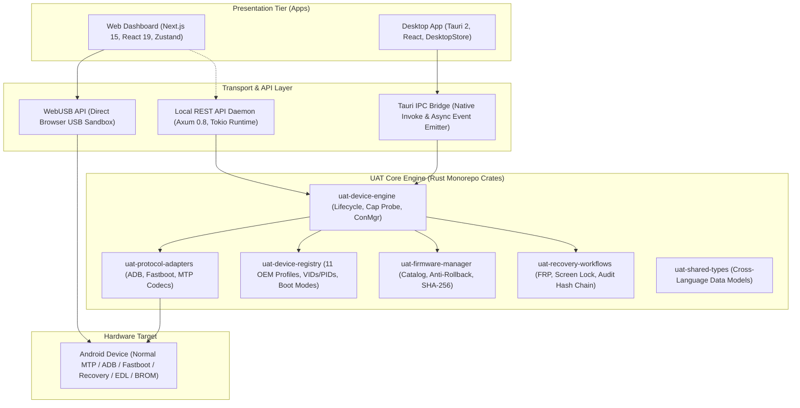

# Universal Android Tool (UAT) — System Architecture

## 1. Executive Architecture Overview

Universal Android Tool (UAT) is an enterprise-grade, modular, cross-platform Android device servicing platform engineered to operate reliably across **Web** (Chromium-based browsers via WebUSB) and **Desktop** (Windows, macOS, and Linux via Tauri 2 and Rust native USB drivers).

The system enforces a strict **Zero-Bypass Policy**: it provides legitimate, manufacturer-authorized diagnostic, recovery, and firmware validation workflows without unauthorized FRP circumvention, bootloader exploit chains, or credential extraction.



---

## 2. Monorepo Structure & Package Topology

The repository is organized as a high-performance monorepo utilizing **pnpm workspaces** for TypeScript applications and **Cargo workspaces** for Rust core libraries and services:

```
universal-android-tools/
├── apps/
│   ├── web/                    # Next.js 15+ Web application (WebUSB, Zustand, Tailwind CSS)
│   └── desktop/                # Tauri 2 Desktop application (React, Vite, Rust Tauri Core)
├── backend/
│   └── rust-api/               # Axum 0.8 REST API daemon (Local device orchestration)
├── packages/
│   ├── shared-types/           # Canonical models (Rust structs + TypeScript interfaces)
│   ├── device-registry/        # 11 OEM hardware profiles, USB VIDs/PIDs, and boot modes
│   ├── protocol-adapters/      # ADB (A_CNXN/A_AUTH), Fastboot (INFO/OKAY/FAIL), MTP
│   ├── device-engine/          # Connection manager, capability detector, operation manager
│   ├── recovery-workflows/     # FRP guidance, screen lock guidance, ownership verification, audit logger
│   └── firmware-manager/       # Verified stock firmware catalog, compatibility checker, SHA-256 verifier
├── docs/                       # Comprehensive technical and security documentation
└── tests/                      # Rust workspace integration test suite (17 automated E2E tests)
```

### Dependency Graph

```
                  ┌──────────────────────┐
                  │   uat-shared-types   │
                  └──────────▲───────────┘
                             │
            ┌────────────────┼────────────────┐
            │                │                │
┌───────────┴──────────┐ ┌───┴──────────┐ ┌───┴───────────────┐
│ uat-device-registry  │ │ uat-firmware │ │   uat-recovery    │
└───────────▲──────────┘ └───▲──────────┘ └───▲───────────────┘
            │                │                │
┌───────────┴──────────┐     │                │
│uat-protocol-adapters │     │                │
└───────────▲──────────┘     │                │
            │                │                │
            └────────┬───────┴────────┬───────┘
                     │                │
           ┌─────────┴────────────────┴─────────┐
           │         uat-device-engine          │
           └─────────▲────────────────▲─────────┘
                     │                │
         ┌───────────┴────┐     ┌─────┴──────────┐
         │  uat-rust-api  │     │  uat-desktop   │
         └────────────────┘     └────────────────┘
```

---

## 3. Communication Architecture: WebUSB vs. Native Desktop

UAT offers two distinct execution environments to meet varying technician requirements:

| Dimension | Web Application (WebUSB) | Desktop Application (Tauri 2) |
|---|---|---|
| **Runtime** | Chromium-based browser (Chrome, Edge, Opera, Brave) | Native binary (.app, .exe, .deb) via WebKit / WebView2 |
| **USB Access Method** | W3C WebUSB API (`navigator.usb`) | Direct OS USB subsystem (`libusb-1.0`, `IOKit`, `WinUSB`) |
| **Permission Model** | Explicit per-session user gesture prompt | OS-level driver access (UDEV rules on Linux) |
| **ADB/Fastboot Handshake** | USB Interface-level framing and packet inspection | Full native socket / direct bulk transfer adapters |
| **Driver Requirements** | No special driver on macOS/Linux; WinUSB on Windows | Native OS drivers (WinUSB / UsbDK on Windows) |
| **Offline Capability** | PWA cached; local execution | 100% offline self-contained executable |

---

## 4. Rust Core Engine Design

### 4.1 Device Discovery & Descriptor Sanitation (`uat-device-engine`)
When a raw USB descriptor is received:
1. `RawUsbDescriptor` extracts Vendor ID (VID), Product ID (PID), manufacturer string, product string, and serial number.
2. `InformationExtractor::sanitize_descriptor` masks sensitive fields (such as MAC addresses or IMEIs). Serial numbers are withheld unless explicitly authorized by the user.
3. `uat-device-registry` matches the VID against 11 primary OEM profiles (Samsung, Google Pixel, Xiaomi, Redmi, POCO, OPPO, Vivo, Realme, Motorola, OnePlus, Nokia) and specialized boot modes (Qualcomm EDL 9008, MediaTek BROM).
4. `CapabilityDetector` evaluates USB interface classes, subclasses, and protocols to determine whether ADB, Fastboot, MTP, or Recovery interfaces are physically present.

### 4.2 Protocol Adapters (`uat-protocol-adapters`)
- **ADB Adapter**:
  - Implements the 24-byte ADB message header codec:
    `[command: u32, arg0: u32, arg1: u32, data_length: u32, data_crc32: u32, magic: u32]`.
  - Handles `A_CNXN` handshakes, `A_AUTH` token challenges, and whitelisted read-only diagnostic commands (`getprop`, `devices -l`).
  - Automatically rejects dangerous commands (`shell rm`, `su`, unauthorized sideloads).
- **Fastboot Adapter**:
  - Encodes Fastboot text commands (`getvar:all`, `getvar:version-bootloader`, `getvar:unlocked`).
  - Decodes Fastboot responses: `INFO` (intermediate data), `OKAY` (command success), `FAIL` (failure reason), `DATA` (payload transfer).
  - Enforces destructive command blocks against `flash`, `erase`, `unlock`, and `oem unlock` without authorized ownership verification.

### 4.3 Firmware Management & Anti-Rollback (`uat-firmware-manager`)
- **Catalog**: Built-in verified OEM stock firmware catalog covering major flagship and midrange devices with hardware SKU aliases (e.g. `husky`, `shiba`, `fuxi`, `SM-S911B`).
- **Compatibility Engine**: Validates exact OEM matching, model/alias congruence, region compatibility (e.g. `EUX`, `Global`, `USA`), and anti-rollback versioning (preventing downgrades to vulnerable bootloaders that could brick hardware).
- **Checksum Verifier**: Cryptographically computes SHA-256 binary digests to verify image integrity before servicing.

### 4.4 Legitimate Recovery & Cryptographic Audit (`uat-recovery-workflows`)
- **Ownership Verification**: Enforces proof-of-purchase, technician ID, customer authorization, and service justification.
- **Tailored Guidance**: OEM-specific hardware key sequences and official service portal links for all 11 brands.
- **Tamper-Evident Audit Logging**: Each workflow execution is recorded into an append-only log with SHA-256 hash chaining (`record_hash = SHA256(prev_hash + audit_id + device_id + timestamp + outcome)`).

---

## 5. Concurrency & Threading Model

- **Tokio Runtime**: All asynchronous operations, USB reads/writes, and network endpoints run on an asynchronous Tokio multithreaded runtime.
- **Device State Safety**: `DeviceConnectionManager` stores connected devices in an `Arc<RwLock<HashMap<String, DeviceInfo>>>`, ensuring thread-safe access across concurrent API calls and IPC invocations.
- **Operation Progress Streaming**: Operations emit incremental status events over Tokio broadcast channels and Tauri event emitters (`diagnostic_event`), providing responsive UI feedback without blocking the main event loop.

---

## 6. Security Boundaries

1. **Host Isolation**: The web application runs in standard browser sandboxing and cannot access files outside of user-prompted file pickers.
2. **Hardware Protection**: Read-only diagnostic probing is preferred; destructive partition modifications are prevented.
3. **Audit Immutability**: Recovery logs cannot be rewritten without invalidating the SHA-256 hash chain.
